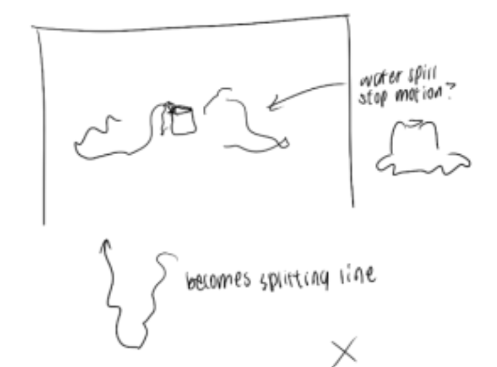

# Portfolio rebrand: brief (v2)

*Started 2026-10-27. Being written up one message at a time. **Nothing gets built or changed in the site code until Amy says so.***

The old draft (`rebrand-brief.md` in the repo root) is kept as reference only. Where the two disagree, this file wins.

This brief has two jobs:

1. **What to build**: every screen, animation and asset, in Amy's own words and sketches.
2. **How to prompt Claude Code to build it**: the phases, and the exact prompt to paste for each one.

Sketches live next to this file in `brief/`, numbered in the order they came in.

---

## 1. What to build

### 1.1 Intro: the water spill

From sketch 01:

- The intro happens inside the site's frame (the big rectangle).
- A small jar sits in the middle. Water spills out of it **on both sides**: a wavy puddle runs out to the left and another to the right.
- **The spill is stop-motion.** It's drawn by hand, frame by frame, not generated by code. (The side drawing shows the jar with the spill pooling all round its base.)
- **The spill becomes the splitting line.** A squiggly line rises upward and turns into the vertical line that divides the page (the line between the sidebar and the stage).

Changes from the old draft:
- The old draft spilled to the left only. This one spills to both sides.
- The old draft had the spill drawn by code (shape morphing). This one uses hand-drawn stop-motion frames.

Still to decide (see section 3):
- Q1, Q2, Q3.

### 1.2 (next sections get added as Amy sends them)

---

## 2. How to prompt Claude Code

*Filled in once the "what to build" part is settled.* Planned shape:

- **One phase per prompt.** Each prompt says which branch to work on, which section of this brief to follow, what "done" looks like, and what not to touch.
- **Assets first.** Any hand-drawn frames get exported before the phase that uses them, with fixed file names and canvas sizes listed here.
- **Every prompt ends with the same checks:** run `npm run build` and lint, look at the page at 1536 × 696 and at phone width, commit on the branch, don't push.
- **Repo notes every prompt includes:** read `AGENTS.md` (this Next.js version differs from what models know), and match the existing code style and comment density.

---

## 3. Open questions

1. **Stop-motion frames for the spill.** How many frames, and what rate? (For example 8–12 drawings at 8 fps, about 1–1.5 seconds.) Will you draw them in Procreate and export each as a PNG or SVG on the same canvas?
2. **Which spill becomes the line?** The left one (towards the sidebar), or both, meeting somewhere? And does the line stay squiggly and hand-drawn on the finished page, or straighten out?
3. **The × at the bottom right of sketch 01.** What does it mean? A close / skip button for the intro, a mark for where something ends up, or nothing?
